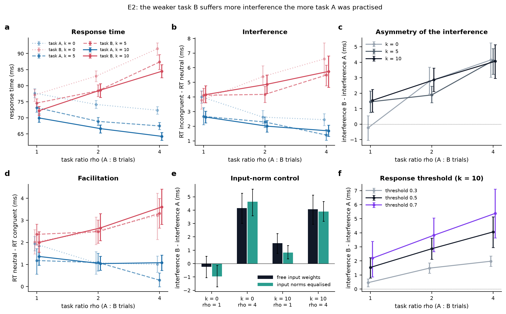
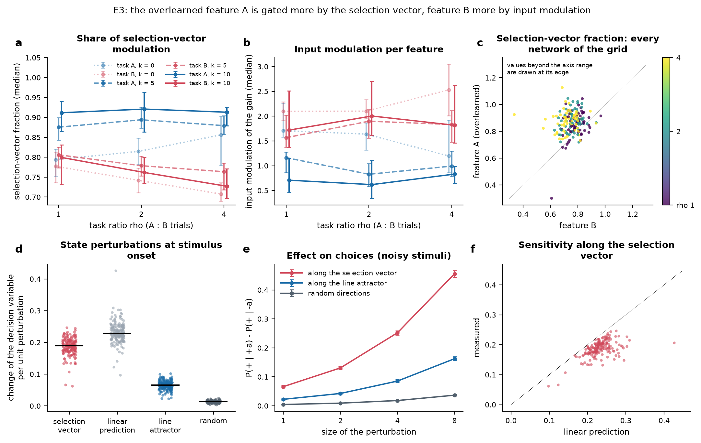
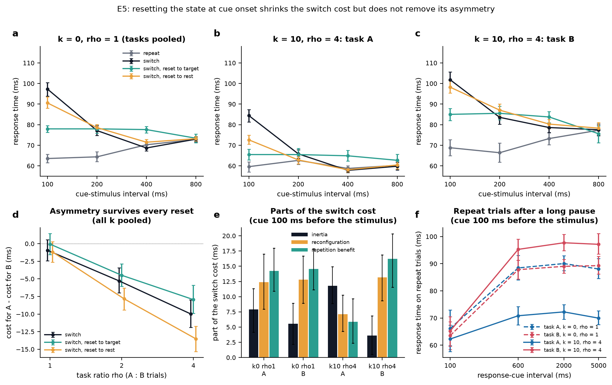

# Learning history, Stroop interference and asymmetric switch costs

**A dynamical-systems analysis of trained recurrent networks**

Course project for CG-501 *Computation and Cognition*, IIT Gandhinagar.
Vishnu Sinha and Devashish Gaur.

Recurrent networks are trained on a cued two-feature decision task with unequal practice on the two tasks. The project measures Stroop-like interference and task-switch costs in the trained networks, and uses fixed points, linearisation and state interventions to find out which mechanism produces them.



*Figure 5. Unequal practice makes the practised task A faster and more resistant to interference, and the weaker task B slower and more open to it.*

## The question

People are slower to name the ink colour of a colour word than to read the word. This is the Stroop effect. A classic account explains it by practice: reading is practised far more than colour naming, so the word interferes with the colour and not the other way round (Cohen, Dunbar & McClelland, 1990). People also pay a time cost when they switch between two tasks, and this cost often differs between the stronger and the weaker task (Allport, Styles & Hsieh, 1994).

The project asks two things:

1. Do both effects appear in a recurrent network that is trained on two tasks with unequal practice?
2. If so, what inside the network produces them?

The network is a standard model of context-dependent decisions (Mante et al., 2013). It receives two noisy stimulus features and a cue, and reports the sign of the cued feature. Because the model is a set of differential equations, its fixed points can be computed and its dynamics linearised around them. That shows how the network selects one feature and ignores the other.

## Model, task and design

**Model.** `tau dh/dt = -h + W_rec phi(h) + W_in u + W_ctx c + noise`, `y = W_out phi(h)`, with 128 units, tau = 100 ms, softplus units and an Euler step of 10 ms. All weights are trained with backpropagation through time. There are three variants: unconstrained ("full"), Dale's law (80% excitatory and 20% inhibitory units) and rank-one recurrent weights.

**Task.** Each trial has a cue, a cue-stimulus interval of 100-800 ms, a 500 ms stimulus with two noisy features, and a hold period. The network reports the sign of the cued feature. Trials come in sequences of six without resetting the network state, so every trial starts from the state the previous one left behind.

**Learning history.** Task A is the practised task. It gets a head start of `k` = 0, 5 or 10 epochs of training alone, and `rho` = 1, 2 or 4 times as many trials as task B during the joint training. `k = 0, rho = 1` is the balanced baseline.

**Conditions.** 31 conditions with 20 networks each (620 networks, fixed seeds):

- the 3 x 3 grid of `k` and `rho`, for full and for Dale networks
- an input-norm control at the four corners of the grid, in which the input weights of the two features are kept at equal norm
- SGD with momentum instead of Adam, at the baseline and at the strongest overlearning
- rank-one networks at the baseline

**Measures.**

| Measure | Definition |
|---|---|
| Response time (RT) | First time after stimulus onset at which the output difference `y1 - y2` exceeds a threshold (0.5; 0.3 and 0.7 as checks) |
| Interference | RT incongruent - RT neutral |
| Facilitation | RT neutral - RT congruent |
| Switch cost | RT after a task switch - RT after a task repeat |
| Selection vector | Left eigenvector of the slow mode of the linearised dynamics. An input is integrated only as far as it overlaps with this vector |
| Selection-vector fraction | Share of the context effect on a feature's gain that comes from a change of the selection vector. The rest comes from a change of the input (input modulation) |

The decomposition into selection-vector modulation and input modulation follows Pagan et al. (2025).

## Experiments and figures

| | Experiment | Figure |
|---|---|---|
| E0 | The analysis code applied to systems with known answers: linear line attractors, a network with a planted slow mode, the Wong & Wang (2006) model, rank-one networks, parameter recovery of the logistic regression | `fig01_validation` |
| | The task and the training | `fig02_task_training` |
| E1 | Replication of Mante et al. (2013) in the balanced baseline | `fig03_replication`, `fig04_state_space` |
| E2 | Interference and facilitation over the grid of learning histories; input-norm control | `fig05_interference` |
| | Noise-free responses to each feature; interference against preparation time (exploratory) | `fig06_mechanism` |
| E3 | Selection-vector modulation against input modulation for each feature; state perturbations | `fig07_decomposition` |
| E4 | Switch costs against preparation time and against the time since the last trial | `fig08_switch_costs` |
| E5 | State resets at cue onset on switch trials; repeat trials after long pauses | `fig09_interventions` |
| E6 | Dale's law and a second optimiser | `fig10_robustness` |
| | Behaviour during joint training (exploratory) | `fig11_training_time_course` |

All figures are in [`figures/`](figures) as PNG and PDF.

## Results

All 620 networks passed the accuracy criterion of 90% (lowest accuracy 95.9%), so none was excluded. Numbers in brackets are 95% bootstrap confidence intervals over networks. Response times are in milliseconds of model time.

| Hypothesis | Outcome |
|---|---|
| **V.** Rank-one networks can only use input modulation | **Supported.** The selection vectors of the two contexts lie on the same axis in 20 of 20 rank-one networks. |
| **H1.** The baseline replicates Mante et al. | **Supported.** Choices depend on the cued feature only (logistic weight 4.08 against 0.02). 19 of 20 networks have one slow mode per context. The selection-vector fraction is 0.78 [0.76, 0.80]. |
| **H2.** Unequal practice gives asymmetric interference | **Supported for the trial ratio.** The interference asymmetry (task B minus task A) grows by 2.06 ms [1.42, 2.70] per doubling of `rho`, and by 2.17 ms [1.74, 2.59] under the input-norm control. The head start `k` has a weaker effect that is not significant under the norm control. |
| **H3.** The overlearned feature is gated more by input modulation | **Not supported: the effect is reversed.** The overlearned feature A has the *higher* selection-vector fraction (0.91 against 0.73 at `k = 10, rho = 4`; median difference over all networks with overlearning 0.12 [0.10, 0.14]). |
| **H4.** Switch costs are asymmetric and depend on overlearning | **Partly.** Switch costs are small, disappear with long preparation, and are larger into the weaker task B (-1.07 ms [-1.84, -0.30] per doubling of `rho`). This is the reverse of the classic human asymmetry, and in the full networks it depends on the response threshold. |
| **H5.** State resets separate inertia, reconfiguration and learned association | **No single account fits.** The cost itself behaves like reconfiguration: it vanishes with preparation time, and at the shortest preparation time it is more than halved when the state is placed in the target configuration. Its asymmetry survives every reset (-7.3, -6.7 and -11.3 ms at `k = 10, rho = 4`), which speaks against inertia. |
| **H6.** The effects hold under Dale's law | **Supported for the trial ratio**, also with SGD. The effect of the head start on interference is absent in Dale networks. |

An exploratory analysis added one more finding: interference is mostly a matter of preparation. It is 7.8 ms when the cue comes 100 ms before the stimulus and 1.1 ms when it comes 800 ms before (`fig06_mechanism`).

The complete statistical output, with every table and test, is in [`results/report.md`](results/report.md).



*Figure 7. The overlearned feature A is gated more by the selection vector, feature B more by input modulation (top row). The decision is far more sensitive to state perturbations along the selection vector than along other directions (bottom row).*



*Figure 9. Resetting the network state at cue onset shrinks the switch cost but does not remove its asymmetry.*

## Caveats

- The effects are small: a few milliseconds on response times of about 65 to 110 ms.
- Interference almost disappears with long preparation. Human Stroop interference does not.
- A larger trial ratio also makes repeats of task B rare during training. The design cannot separate this from the amount of practice.
- The networks have approximate line attractors (a valley of slow points around one stable fixed point). Depending on the condition, up to 25% of the full networks and 10-35% of the Dale networks miss the strict criteria for a slow mode.
- `results/report.md` contains roughly a thousand p-values without a correction for multiple testing. The conclusions above rest on effects that are below .001 and that repeat in separately trained sets of networks.
- Medians and median regression are used for the quantities of the linearisation. This was not planned in advance. It was introduced because single networks without a clean slow mode give extreme ratios.
- The comparison with human behaviour is qualitative only.

## Repository layout

| Path | Content |
|---|---|
| `stroop_rnn/config.py` | Every design constant, the list of conditions and the seeds |
| `stroop_rnn/task.py` | Trial sequences (cue, cue-stimulus interval, noisy stimulus, hold period) |
| `stroop_rnn/model.py` | Batched rate networks: unconstrained, Dale's law, rank-one |
| `stroop_rnn/train.py` | Training with pre-training on task A, trial ratio and input-norm control |
| `stroop_rnn/fixedpoints.py`, `dynamics.py` | Fixed and slow points, linearisation, selection vector, decomposition of the gain change |
| `stroop_rnn/behavior.py` | Response times, interference, facilitation, switch costs |
| `stroop_rnn/experiments.py` | Test batteries, perturbations, state resets, noise-free responses |
| `stroop_rnn/stats.py` | Bootstrap intervals, permutation tests, logistic regression |
| `stroop_rnn/validation.py` | Systems with known fixed points (linear line attractor, Wong & Wang model) |
| `scripts/` | One script per stage of the pipeline, and `run_all.sh` for all of them |
| `tests/` | Unit tests of the task, the model and the fixed-point analysis |
| `results/report.md` | Complete statistical output |
| `results/networks.csv` | One row per network (620 rows) with every measure |
| `results/stats.json` | The statistics in machine-readable form |
| `results/*.npz`, `results/snapshots.csv` | Arrays behind the figures: cell means, psychometric curves, eigenvalues, training history, snapshots during training |
| `figures/` | Figures 1-11 |

## Reproducing the results

Requirements: Python 3.11 or newer and [uv](https://docs.astral.sh/uv/).

```bash
git clone https://github.com/Vish-Overflows/stroop-rnn.git
cd stroop-rnn
uv sync

scripts/run_all.sh --figures-only     # statistics and figures from the tables in results/
scripts/run_all.sh                    # everything, including the training
scripts/run_all.sh --skip-training    # start from trained networks in runs/main
uv run pytest                         # unit tests
```

Training all 620 networks takes several hours on a 10-core laptop. The trained networks are written to `runs/`, which is not part of the repository. The tables in `results/` are, so the statistics and figures can be regenerated without training.

Seeds are fixed: see `network_seeds` in `stroop_rnn/config.py` and `TEST_SEED` in `stroop_rnn/experiments.py`.

Single stages:

| Script | Stage |
|---|---|
| `scripts/run_training.py` | Train the 31 conditions (20 networks each) |
| `scripts/run_analysis.py` | Fixed points, linearisation and experiments E1-E5 for every network; `--snapshots` for the networks saved during training |
| `scripts/e0_validation.py` | E0: the analysis applied to systems with known answers |
| `scripts/collect_results.py` | Collect everything into the tables in `results/` |
| `scripts/run_stats.py` | Statistics; writes `results/report.md` and `results/stats.json` |
| `scripts/make_figures.py` | All figures; `--only 5 9` for single figures |

## References

- Allport, D. A., Styles, E. A., & Hsieh, S. (1994). Shifting intentional set: Exploring the dynamic control of tasks. In C. Umiltà & M. Moscovitch (Eds.), *Attention and Performance XV* (pp. 421-452). MIT Press.
- Cohen, J. D., Dunbar, K., & McClelland, J. L. (1990). On the control of automatic processes: A parallel distributed processing account of the Stroop effect. *Psychological Review, 97*(3), 332-361.
- Mante, V., Sussillo, D., Shenoy, K. V., & Newsome, W. T. (2013). Context-dependent computation by recurrent dynamics in prefrontal cortex. *Nature, 503*, 78-84.
- Pagan, M., Tang, V. D., Aoi, M. C., Pillow, J. W., Mante, V., Sussillo, D., & Brody, C. D. (2025). Individual variability of neural computations underlying flexible decisions. *Nature*.
- Wong, K.-F., & Wang, X.-J. (2006). A recurrent network mechanism of time integration in perceptual decisions. *Journal of Neuroscience, 26*(4), 1314-1328.
